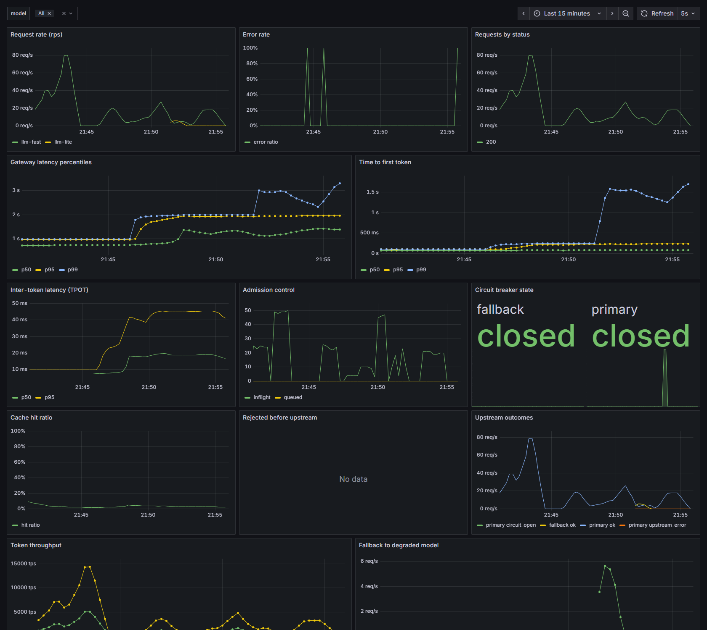
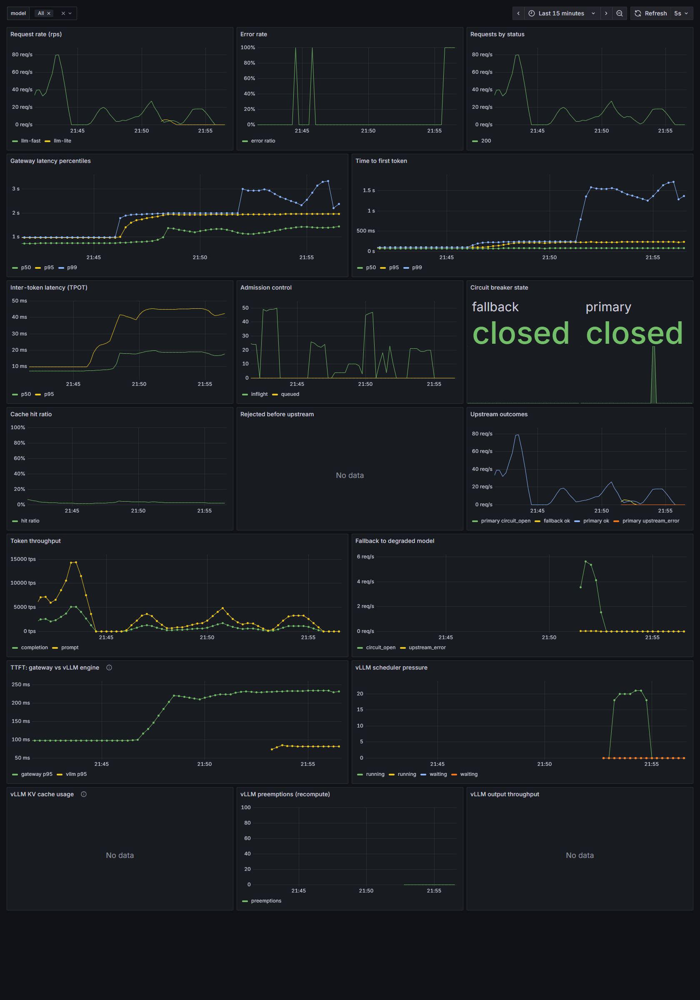

# LLM Serving Lab — Gateway + Model Service

一个可部署、可压测、有真实错误处理、能产出性能数据的后端 + 模型服务项目。

做的不是"调一个 API"，而是把 **LLM 服务化** 这件事里最容易出错的几层自己做出来：
准入控制、限流、熔断、重试与降级、流式转发的 TTFT/TPOT、缓存、可观测性，
以及一套能真正把这些路径跑出来的压测工具。

> **English summary** — A deployable LLM gateway + model service written in
> FastAPI. It implements the layers that actually break in production:
> per-tenant rate limiting, exact-match response caching, admission control
> (inflight cap + bounded queue), circuit breaking, retry with degraded
> fallback, and SSE streaming with in-band error events.
>
> Bundled with it is a load harness that measures what LLM serving actually
> cares about — **TTFT** and **TPOT**, not just RPS — and separates timeout,
> circuit-open, rate-limited, truncated-stream and upstream-5xx failures.
> Ships with Docker Compose, Prometheus, and a 13-panel Grafana dashboard;
> validated against a real vLLM backend (Qwen2.5-1.5B primary + 0.5B
> fallback on a single 8GB GPU).

---

## 为什么是这个组合

一个只会返回固定 JSON 的 mock 服务，压测出来只有 RPS 一个数字，说明不了任何问题。
LLM 场景真正难的地方在于：

- 响应是**流式**的，"成功"不是一个状态，而是一段时间内的事件序列；
- 慢的根源有三个：**首 token 延迟（TTFT）**、**token 间延迟（TPOT）**、**排队**；
- 上游会**半死不活**（超时、5xx、空响应、流中断），而不是干脆不接；
- 流已经开始输出后**不能重试**，否则客户端会收到重复内容。

所以本项目把上游做成**可注入故障**的模拟推理服务：非 happy path 时，
网关的重试 / 熔断 / 降级 / 流中断处理是真的会被执行到，并且有指标可查。

---

## 架构

```text
                      +------------------------------------------+
   clients ---------> |              LLM Gateway               |
   (SSE / JSON)       |                                          |
                      |  1. per-tenant rate limit (rpm + tpm)    |
                      |  2. response cache (exact match)        |
                      |  3. admission control (inflight + queue) |
                      |  4. upstream call                       |
                      |       +-- retry (non-streaming only)     |
                      |       +-- circuit breaker                |
                      |       +-- fallback -> degraded model     |
                      +---------------+--------------------------+
                                      |  /metrics  /admin/status
                    +-----------------+-----------------+
                    v                                   v
        +-----------------------+           +-----------------------+
        |  model-a  (llm-fast)  |           |  model-b  (llm-lite)  |
        |  primary / good model |           |  degraded fallback    |
        |  fault injection      |           |  fault injection      |
        +-----------------------+           +-----------------------+
                    |                                   |
                    +----------> Prometheus <-----------+
                                      |
                                      v
                                  Grafana
```

| 目录 | 内容 |
| --- | --- |
| `services/api/` | 网关：路由、限流、准入、缓存、熔断、降级、指标 |
| `services/model_service/` | 模拟推理服务：可配延迟画像 + 故障注入 |
| `services/common/` | 配置、结构化日志、Prometheus 指标封装、SSE 编解码 |
| `load/` | 压测工具：TTFT/TPOT 感知的负载生成 + 报告 |
| `deploy/` | Dockerfile、compose、Prometheus、Grafana 面板 |
| `scripts/` | 本地起停、压测、混沌开关、场景编排 |
| `tests/` | 23 个单测/集成测试 |

---

## 快速开始

### 本地（无需 Docker）

```powershell
uv sync --extra dev
pwsh -File scripts/dev.ps1          # 起 model-a / model-b / gateway

# 冒烟
curl.exe -N -X POST http://127.0.0.1:8000/v1/chat/completions `
  -H "content-type: application/json" `
  -d '{"messages":[{"role":"user","content":"hi"}],"max_tokens":16,"stream":true}'

pwsh -File scripts/dev.ps1 -Stop    # 停
```

### Docker

```powershell
# 能直连 docker.io 时
docker compose -f deploy/docker-compose.yml up -d --build

# 网络受限时走镜像源
docker compose --env-file deploy/docker.env -f deploy/docker-compose.yml up -d --build
```

| 服务 | 地址 |
| --- | --- |
| Gateway | http://127.0.0.1:8000 |
| Metrics | http://127.0.0.1:8000/metrics |
| Gateway 状态 | http://127.0.0.1:8000/admin/status |
| Prometheus | http://127.0.0.1:9090 |
| Grafana | http://127.0.0.1:3000 |

Grafana 面板默认匿名可访问。Prometheus / Grafana 放在 `observability` profile 里，
即使拉不到镜像也不影响核心栈启动。

预置的 Grafana 面板（13 个）：请求速率、错误率、状态码分布、网关延迟分位、
TTFT、token 间延迟、准入水位、熔断器状态、缓存命中率、拒绝原因、上游结果分布、
token 吞吐、降级次数。



接上 vLLM 后还会多出 4 个**引擎侧**面板（下面这张图的下半部分）：
网关 TTFT vs 引擎 TTFT 对比、vLLM 调度压力、KV cache 占用、抢占重算次数。
对比那两 TTFT 的间距，就是网关 + 网络引入的固定开销。



---

## 压测

### 为什么不用 k6

k6 测的是 HTTP 请求级指标。而 LLM 服务真正的 SLO 是 **TTFT** 和 **TPOT**，
响应还在流的时候根本不知道这次请求算不算成功。
所以本项目自带压测工具：它按 token 统计首字延迟、token 间延迟、输出速率，
并能区分"超时 / 熔断 / 限流 / 流被截断 / 上游 5xx"这些不同的失败原因。

### 用法

```powershell
# 单次
pwsh -File scripts/loadtest.ps1 -Duration 30 -Concurrency 24

# 参考场景（本地跑，Windows 客户端有 ~40ms 开销，数字偏大）
pwsh -File scripts/scenarios.ps1

# 参考场景（在容器里跑，Linux 客户端，数字可信 —— 推荐）
pwsh -File scripts/scenarios-docker.ps1

# 直接调
uv run python -m load.harness --url http://127.0.0.1:8000 `
  --duration 30 --concurrency 24 --ramp 6 --unique-prompts 2000 --rate 24 `
  --out reports/load-latest.json
```

输出同时写到 JSON 和 Markdown：`reports/scenario-*.json` / `.md`。

#### 两种负载模型

| 模式 | 参数 | 什么时候用 |
| --- | --- | --- |
| 闭环（默认） | 只给 `--concurrency` | 每个 worker 打完一个立刻打下一个。测的是"客户端能打多快"，容易先撞上限流器 |
| 恒定到达率 | 加 `--rate 24` | 按固定 RPS 发请求。测的是"服务端在某个负载下的表现"，这才是容量规划需要的数字 |

这个区别很重要：闭环模式下客户端把服务端打到 429，看起来像"服务端只能扛 30 rps"，
其实只是限流阈值被碰到了。


### 故障注入

模型服务的每个请求都有概率被替换成一种故障，用来验证网关的错误路径：

| 模式 | 效果 | 验证网关的哪条路径 |
| --- | --- | --- |
| `http_500` / `http_503` | 直接返回错误 | 重试 -> 熔断 -> 降级 |
| `timeout` | 挂起不返回 | 读超时 -> 重试 -> 熔断 |
| `slow` | 首 token 前额外延迟 | TTFT 长尾 |
| `empty` | 200 但空 body | 空响应处理 |
| `malformed_sse` | 流中途损坏 | 流中断 -> in-band error event |

```powershell
pwsh -File scripts/chaos.ps1 -Target http://127.0.0.1:8101 -Mode http_500 -Rate 0.5 -Duration 20
pwsh -File scripts/chaos.ps1 -Target http://127.0.0.1:8101 -Clear
```

压测工具也支持中途注入：`--chaos-url --chaos-mode --chaos-rate --chaos-at`。

---

## 实测结果

环境：28 核 Windows 主机，Docker (Linux) 里跑全部服务，
压测客户端也在容器里（`scripts/scenarios-docker.ps1`）。
模型配置：`llm-fast` = 80ms prefill + 120 tok/s，`llm-lite` = 30ms prefill + 220 tok/s，
prompt 180 token、输出 96 token、限流 6000 rpm / 6M tpm、准入 64 并发 + 256 队列。

| 场景 | 到达率 | RPS | 错误率 | 延迟 p50 | TTFT p50 | token 间 p50 | 缓存命中 | 路由 |
| --- | --- | --- | --- | --- | --- | --- | --- | --- |
| baseline | 24 rps | 23.4 | 0% | 889 ms | 95.7 ms | 8.34 ms | 21% | primary 579 / cache 152 |
| cache | 24 rps | 23.4 | 0% | **5.0 ms** | **4.2 ms** | **0.01 ms** | 100% | cache 491 |
| cache 饱和 | 400 rps | 397 | **75% (429)** | 1.9 ms | 1.5 ms | 0.01 ms | 25% | — |
| 上游半挂（50% 500） | 24 rps | 23.2 | **0%** | 475 ms | 43.6 ms | 4.55 ms | 26% | primary 298 / **fallback 237** |
| 上游全挂（100% 500） | 24 rps | 23.1 | **0%** | 474 ms | 41.6 ms | 4.54 ms | 25% | primary 151 / **fallback 390** |
| 过载（默认准入 64+256） | 闭环 | 69.8 | 0% | 1775 ms | 981 ms | 8.35 ms | 3% | — |
| 过载（收紧准入 8+16） | 闭环 | 287 | **96.9%**（429×5430 / 503×2230） | 231 ms | 2069 ms | 8.41 ms | 0.3% | — |

### 几个能互相印证的点

**1. 测量链路是自洽的。**
baseline 的延迟 p50 = 889 ms，而 TTFT 95.7 ms + 95 个 token × 8.34 ms = 888 ms。
差 1 ms。延迟、TTFT、token 间延迟三个独立测出来的量能对上，说明测量本身没错。

**2. token 间延迟 8.34 ms 正好是配置值。**
模型配的是 120 tok/s，即 1/120 = 8.33 ms。
早期版本用 `sleep(8.33ms)` 逐 token 累加，抖动会累积到 11 ms；
改成按绝对时间表排程（`engine.pace()`）之后测量值和配置值严丝合缝。

**3. 降级路径真的接住了流量，而且客户端完全无感。**
上游 100% 返回 500 时，客户端错误率是 **0%**：390 个请求被自动分流到 fallback，
熔断器打开后后续请求直接短路到 fallback，不再打上游。
故障窗口结束后熔断器**自动恢复**（half-open 探测成功 -> closed）。

顺带一个反直觉的观察：降级后延迟 p50 从 889 ms 降到 474 ms ——
因为 fallback 模型更快（220 tok/s vs 120 tok/s）。**降级不等于变慢**，
取决于降级目标是什么。

**4. 两道闸是独立的，而且顺序是限流 -> 准入。**
过载场景收紧准入（8 并发 + 16 队列）后，`llm_api_rejected_total` 里
同时出现了 `request_rate`（限流器）和 `overloaded`（准入控制）两类拒绝，
`peak_inflight` 精确等于 8、`peak_queue` 精确等于 16 ——
边界是被严格执行的，不是大概。

**5. 缓存不是免费的。**
同样 24 rps 到达率下，缓存让延迟从 889 ms 掉到 5 ms（**179 倍**）。
但把到达率提到 400 rps，75% 被限流器挡下：缓存让请求变快，
逻辑 token 的消耗速率也跟着变快（这里统计的是逻辑 token，不是真实推理消耗，
这个语义差异是当前实现的一个已知简化）。

### 压测工具自身的测量下限

这条容易踩坑，所以单独测了：`scripts/client-floor.py` 用同一个 httpx 客户端打
一个空接口（`/healthz`）。

| 客户端 | 平台 | p50 | 说明 |
| --- | --- | --- | --- |
| `curl` | Windows | 3 ms | 服务端真实响应时间 |
| Python httpx | Windows | **40–50 ms** | asyncio socket 每次请求多付 ~40 ms |
| Python httpx | Linux 容器 | ~1 ms | 无此问题 |

所以在 Windows 上直接跑压测，**所有延迟数字都要减掉约 40 ms**。
这也是 `scripts/scenarios-docker.ps1` 存在的原因：压测客户端应该和服务端在同一个平台，
或者至少在一台网络开销可忽略的机器上。


---

## 关键设计取舍

### 熔断器按"请求"计数，不按"调用"计数

重试发生在熔断器**内部**。一次失败请求重试 3 次，如果每次尝试都记一次失败，
2 个请求就能把熔断器打开 —— 这显然不对。熔断器应该看到的是"这次客户端请求最终成功了没有"。

### 流式请求不重试

字节已经上线，重试会让客户端收到重复内容。
流开始之前失败 -> 可以降级到 fallback；流开始之后失败 -> 只能发一个 in-band
`event: error` 让客户端知道这次生成不完整。

### 有界队列 + 早拒绝

准入控制同时限制**并发数**和**等待队列长度**，队列满直接 503 + `Retry-After`。
无界队列会把延迟问题变成内存问题和超时问题 —— 客户端宁可早点拿到 503，
也不要等 30 秒然后超时。

### 准入槽位在取消时也要归还

`release()` 先同步递减计数再拿锁 notify。如果先 await 再递减，
一次取消就会永久泄漏一个槽位，最后所有请求都被拒。

### 缓存只在 temperature = 0 时生效

缓存键包含 model / messages / max_tokens / temperature。
采样类请求（temperature > 0）命中缓存等于返回错误的分布。

### 缓存命中不占准入槽位

命中缓存没有上游成本，不应该和真实推理抢同一个并发池。

---

## 指标

网关（`/metrics`）：

| 指标 | 含义 |
| --- | --- |
| `llm_api_requests_total{endpoint,model,tenant,status,stream}` | 请求数与状态分布 |
| `llm_api_request_duration_seconds` | 端到端延迟直方图 |
| `llm_api_time_to_first_token_seconds` | **TTFT** |
| `llm_api_time_per_output_token_seconds` | **TPOT**（token 间延迟） |
| `llm_api_tokens_total{model,direction}` | token 计数 |
| `llm_api_upstream_requests_total{upstream,outcome}` | 上游调用结果分布 |
| `llm_api_upstream_retry_total{upstream,reason}` | 重试次数与原因 |
| `llm_api_circuit_state{upstream}` | 熔断器状态：0 closed / 1 half-open / 2 open |
| `llm_api_inflight_requests` / `llm_api_queue_depth` | 准入控制实时水位 |
| `llm_api_rejected_total{reason}` | 入口拒绝（限流 / 过载） |
| `llm_api_cache_total{result}` | 缓存命中 / 未命中 |
| `llm_api_fallback_total{reason}` | 降级次数 |
| `llm_api_queue_wait_seconds` | 排队等待时间 |

模型服务：`model_requests_total`、`model_time_to_first_token_seconds`、
`model_tokens_total`、`model_active_requests`、`model_faults_injected_total` 等。

> 生产环境注意 `tenant` label 的基数问题。上生产前把它换成"租户分桶"，
> 或者干脆从指标里去掉，只留在日志里。

---

## 接入真的 vLLM

模型服务的后端是可插拔的（`services/model_service/backends/`）：
`mock`（模拟引擎）和 `vllm`（真实推理服务），用 `MODEL_BACKEND` 切换。
**网关侧一行都不用改** —— vLLM 本来就说的是 OpenAI 方言。

### 拓扑

```text
   load client
       |
       v
  LLM Gateway (Docker)  ---- 限流 / 缓存 / 准入 / 熔断 / 降级
       |            |
       v            v
 model-a proxy   model-b proxy        <-- 故障注入 + 准入控制留在这层
  (Docker)          (Docker)
       |            |
       v            v
 vLLM 1.5B       vLLM 0.5B            <-- 真实推理，GPU
  (WSL2/GPU)      (WSL2/GPU)
```

**为什么故障注入要留在 vLLM 前面？**
如果让 vLLM 自己返回 500，熔断/降级就测不到了 —— 引擎只会在显存不足时失败，
你没法稳定复现"上游半挂"。所以模型服务仍然作为一层代理挡在 vLLM 前面：
它负责注入故障、做准入控制、把两个后端的指标口径统一。

这层代理只做转发和计数，SSE 字节**原样透传**（不重新序列化），
所以它几乎不引入额外延迟。

### 方式一：Docker + GPU（生产形态）

```powershell
docker compose --env-file deploy/docker.env.vllm -f deploy/docker-compose.yml `
  --profile vllm --profile observability up -d
```

`deploy/docker.env.vllm` 里把 `MODEL_BACKEND` 置为 `vllm`，
compose 会额外起一个带 `nvidia` GPU reservation 的 `vllm` 服务。

### 方式二：WSL2 原生（本机开发，GPU 直通）

Windows 上 vLLM 官方不支持，但在 WSL2 里可以跑（GPU 直通可用）。
安装脚本把所有东西放在 `/mnt/d`，不占系统盘：

```powershell
# 1. 装 vLLM（拉 torch + CUDA wheels，约 8GB，十几分钟）
wsl -d Ubuntu-22.04 -- bash "/mnt/d/AI infra/scripts/setup-vllm-wsl.sh"

# 2. 起 vLLM（两个：一个主模型，一个降级用的小模型）
pwsh -File scripts/run-vllm-wsl.ps1 -Start

# 3. 把模型服务指向 vLLM 并跑场景
pwsh -File scripts/run-vllm-wsl.ps1 -Scenario baseline

# 4. 停
pwsh -File scripts/run-vllm-wsl.ps1 -Stop
```

`setup-vllm-wsl.sh` 默认走 `hf-mirror.com` —— 直连 huggingface.co 在很多网络下不通。

### 显存怎么分

单卡 8GB 上跑两个 vLLM 实例：

| 实例 | 模型 | `--gpu-memory-utilization` | 说明 |
| --- | --- | --- | --- |
| big | Qwen2.5-1.5B-Instruct | 0.60 | 权重 ~3GB，剩 ~2.2GB 给 KV cache（≈78k token） |
| small | Qwen2.5-0.5B-Instruct | 0.22 | 降级目标，权重 ~1GB，KV cache ~27k token |

剩下的留给 Windows 合成器和驱动（两个实例合计 0.82，Windows 自己还要 ~0.5GB）。
`--max-num-seqs` 必须和 KV cache 容量匹配 —— KV cache 不够时 vLLM 会
**抢占重算**（preemption），表现为 p99 突然翻几倍。

### 换成自己的模型

```powershell
pwsh -File scripts/run-vllm-wsl.ps1 -Start `
  -BigModel Qwen/Qwen2.5-3B-Instruct `
  -SmallModel Qwen/Qwen2.5-0.5B-Instruct
```

3B 在 8GB 上要调低 `--gpu-memory-utilization` 并缩短 `--max-model-len`，
否则 vLLM 启动时会因为 KV cache 算不过来而 OOM。

---

## vLLM 实测结果

环境：RTX 4070 Laptop（8GB）、Qwen2.5-1.5B-Instruct（主）+ Qwen2.5-0.5B-Instruct（降级），
两个 vLLM 实例共享一张卡（`--gpu-memory-utilization` 0.60 / 0.74），
网关与压测客户端在 Docker 里，引擎在 WSL2。

### 容量扫描（恒定到达率，64 输出 token）

| 到达率 | 实测 rps | 延迟 p50 | 延迟 p95 | TTFT p50 | token 间 p50 |
| --- | --- | --- | --- | --- | --- |
| 5 rps | 4.13 | 919 ms | 961 ms | 56 ms | 13.73 ms |
| 10 rps | 9.06 | 965 ms | 1012 ms | 58 ms | 14.46 ms |
| 20 rps | 19.58 | 1214 ms | 1287 ms | 79 ms | 17.84 ms |
| 30 rps | 27.65 | 1655 ms | 1733 ms | 109 ms | 24.68 ms |

**拐点在 20 rps 附近。** 低于它，延迟几乎不随负载变化（919 → 965ms）；
高于它，每条流的解码速度线性下降（13.7 → 24.7ms），延迟跟着涨。
引擎没有排队（`num_requests_waiting = 0`），也没有抢占（`num_preemptions = 0`）——
**瓶颈是 GPU 算力，不是显存，也不是调度器。** 这和 mock 给出的"负载无关"延迟
完全是两回事。

### 网关和引擎互证

同一批请求，两边各测一遍：

| 指标 | 网关侧 | 引擎侧（vLLM） | 差值 |
| --- | --- | --- | --- |
| 端到端延迟（均值） | 1214 ms | 1187 ms | 网关 +27 ms |
| TTFT（均值） | 79 ms | 58.7 ms | 网关 +20 ms |
| token 间延迟（均值） | **17.84 ms** | **17.93 ms** | **0.5%** |
| 生成 token 数 | 64 / 请求 | 88 920 / 1391 = 64 | 一致 |

token 间延迟两边几乎完全一致（差 0.5%）—— 说明**测量链路本身是准的**，
而网关额外引入的开销（20–27ms）就是代理层 + 跨 WSL/Docker 网络的固定成本。
这也是"用真后端"最大的价值：mock 给的 8.35ms 是编出来的，真实是 17.9ms。

### 上游故障时的降级（真实引擎）

给 model-a 注入 100% 的 500 故障，持续 25 秒：

| 指标 | 结果 |
| --- | --- |
| 客户端错误率 | **0%**（580 请求全部成功） |
| 路由 | primary 253 / **fallback 303** |
| 延迟 p50 / p95 / p99 | 965 ms / **2558 ms** / **4271 ms** |
| TTFT p95 | **1463 ms**（正常 103 ms） |

降级链路在指标里完整可查：

```text
llm_api_upstream_requests_total{outcome="upstream_error",upstream="primary"} 7
llm_api_upstream_requests_total{outcome="circuit_open",upstream="primary"}   296
llm_api_fallback_total{reason="upstream_error"}                              7
llm_api_fallback_total{reason="circuit_open"}                              296
```

7 个请求先撞到 500（重试后仍失败）→ 降级；之后熔断器打开，296 个请求直接短路到
fallback，不再打上游。故障窗口结束后熔断器**自动恢复**（half-open 探测成功 → closed）。

两个值得记的点：

1. **降级不等于变慢。** p50 从 965ms 变成 965ms，因为 fallback 是更小的模型，
   解码更快（token 间 5.78ms vs 14.46ms）。真正变慢的是长尾：p95/p99 涨了 2–4 倍，
   因为熔断器打开前的重试和半开探测会堆积请求。
2. **降级路径需要"故障可注入"才测得出来。** vLLM 自己不会稳定地返回 500，
   所以故障注入必须放在 vLLM **前面**的那层代理里 —— 这也是这个项目保留
   model-service 代理层的原因。


---

## 已知边界

- 本地跑在 Windows 上，定时器粒度会影响模拟解码速度；
  `services/model_service/app.py` 里调了 `timeBeginPeriod(1)` 把精度提到 1ms，
  Docker (Linux) 上没有这个问题。
- `tenant` 作为指标 label 会造成高基数，生产环境需要改造。
- 熔断器是单进程内存态；多副本部署时每个副本各断各的，
  生产上要么做共享状态，要么让上游自己承担熔断职责。
- 缓存是进程内 LRU，多副本之间不共享。

### WSL2 上跑 vLLM 踩过的坑

这几个都是环境相关的，但换个机器大概率还会遇到，所以记在这里：

| 现象 | 原因 | 处理 |
| --- | --- | --- |
| vLLM 启动卡在 9 分钟，进程状态是 `D`（不可中断 IO），`wchan=p9_client_rpc` | venv 放在 `/mnt/d`（DrvFs/9p），vLLM 启动要 import 几万个文件，每个都是一次 9p RPC | venv 和发行版都放本地 ext4。`wsl --import` 到 D: 的新发行版是最省事的做法 |
| `uv pip install` 报 `CaUsedAsEndEntity` | 网络上有 TLS 中间人，uv 自带的证书链校验不过 | `uv pip install --system-certs`（用发行版的 CA store） |
| `Failed to find C compiler` | ubuntu-base 没有 gcc，而 Triton 的 JIT 要现场编译 kernel | `apt-get install build-essential` |
| `Could not find nvcc and default cuda_home='/usr/local/cuda' doesn't exist` | pip 装的 nvidia 包里有 nvcc，但不在 CUDA 期望的目录布局 | 把 `CUDA_HOME` 指到 `site-packages/nvidia/cu13` |
| `CUDA compiler and CUDA toolkit headers are incompatible` | pip 版 nvcc 和 flashinfer 自带的 CUDA 头文件版本对不上 | 绕开 flashinfer：`VLLM_ATTENTION_BACKEND=TRITON_ATTN` + `VLLM_USE_FLASHINFER_SAMPLER=0`（装了完整 CUDA toolkit 的话可以改回 FLASHINFER） |
| 模型下载卡住 / 速度只有 300KB/s | hf-mirror 的 CDN 单连接限速，且连接会静默挂死 | 换 ModelScope，并用并发 Range 请求分块下载（`scripts/download-model.sh`），下完校验 sha256 |
| `docker compose run` 把 model 服务重建成了 mock | `run` 会重建配置有差异的依赖服务，而环境变量只在那个 shell 里 | 把后端配置固化到 env 文件（`deploy/docker.env.wsl`），所有 compose 命令用同一个 `--env-file` |

另一个容易忽略的点：**切换上游后要清网关缓存**。缓存键是请求内容，
不包含上游身份，换了引擎之后同样的请求会命中旧引擎的缓存。
`DELETE /admin/cache`。

---

## 测试

```powershell
uv run pytest -q
```

覆盖：熔断器三态转换、令牌桶与准入控制、缓存 TTL/LRU、
网关端到端（正常 / 缓存命中 / 降级 / 双上游失败 / 限流 / 过载 / 流式转发）。


